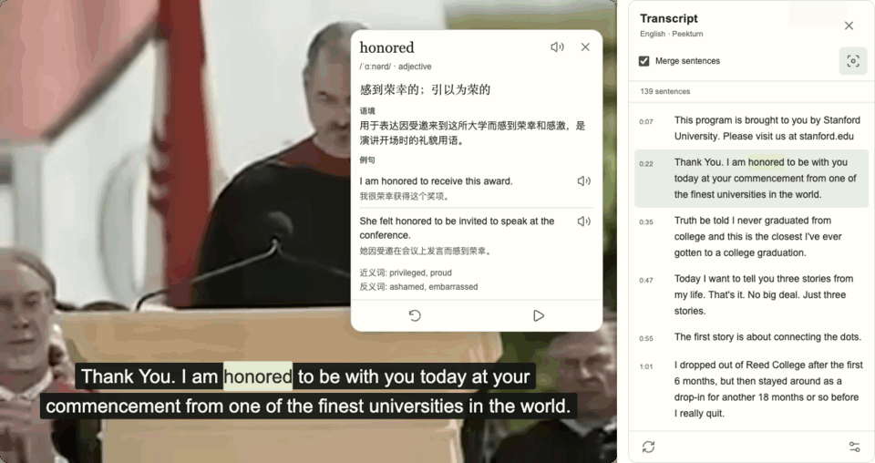
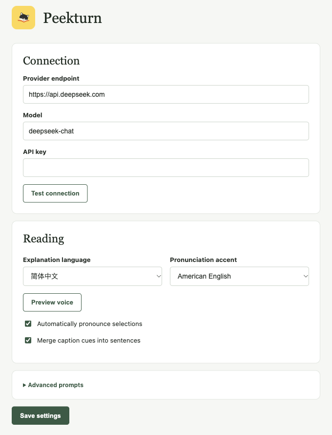

<div align="center">
  
  <h1>Peekturn for YouTube</h1>
  <p>Watch videos, read complete English sentences.</p>
  <p><a href="README.md">简体中文</a> · English</p>
  <p>Chrome Manifest V3 · Apache-2.0</p>
</div>



<p align="center"><sub>Real extension capture · 12.5 seconds · about 2 MB · GIF has no audio</sub></p>

Peekturn is a standalone Chrome extension in the same family as [Peekturn for Android](https://github.com/Wake-C/peekturn). Click a word in the captions or transcript on YouTube to see an explanation in context.

## Read as you watch

- **Complete sentences:** Model-assisted caption merging is on by default for both the video captions and the transcript. Groups have length and timing limits and preserve the source text. Completed results are cached locally for repeat visits; changed captions, models, or merge rules trigger a fresh merge. While merging is pending or unavailable, the interface says so and shows the original captions.
- **Word explanations:** Click a word in either surface to open a compact in-video explanation with meaning, context, and examples. Choose English or Simplified Chinese, and use, customize, or restore the default prompt for either language.
- **Pronunciation:** Selected words are spoken automatically by default, with US and UK accents available. Speaker buttons beside words and examples play or stop speech.
- **Playback controls:** Looking up a word pauses the video. Clicking outside dismisses the explanation and resumes playback if the lookup interrupted it; an already-paused video stays paused. The close button keeps playback paused. You can also replay the sentence or resume explicitly.
- **Follow the transcript:** The compact right-hand transcript highlights the active cue, and timestamps seek through the video. Scrolling stops follow mode; use the follow button to return to the current position. The copy icon in the header copies the full transcript without timestamps.

## Install

1. On the [GitHub repository](https://github.com/Wake-C/peekturn-extension), choose **Code → Download ZIP** and extract the downloaded file.
2. Open `chrome://extensions` in Chrome and turn on **Developer mode**.
3. Select **Load unpacked** and choose the extracted folder containing `manifest.json`.

No npm install or build is needed to load the extension. Click the Peekturn icon in the Chrome toolbar to open settings.

## Configure a model

<p align="center"></p>

1. Bring your own model API key. The default Provider endpoint is `https://api.deepseek.com` and the default Model is `deepseek-chat`. You can instead use an OpenAI-compatible HTTPS provider that supports JSON output and its model.
2. Enter the **Provider endpoint**, **Model**, and **API key** in settings, then select **Save settings**. Allow access to the provider host if Chrome asks.
3. Select **Test connection** to confirm that the model returns a valid structured answer. Then open a YouTube video with English captions; turn on YouTube captions first if needed.

Settings also control explanation language, pronunciation, sentence merging, and prompts. Provider charges and data handling depend on the service you choose.

## Privacy and limits

The API key is stored in Chrome's local extension storage, not an OS-encrypted vault; the extension does not expose the key to the page. For a lookup, the configured model provider receives the selected word, nearby captions, video title, and timestamp. When sentence merging is enabled, caption segments are sent to the provider too. The extension does not send application telemetry.

The merge cache stores only content fingerprints, group boundaries, and timestamps for up to 30 days. It is limited to 1 MiB and evicts the least recently used results when full.

Pronunciation uses Chrome text-to-speech. Available voices vary by browser and operating system, and some voices may use a network. Model explanations and merging require an available model service; offline AI is not promised.

The video must have English captions. The extension also depends on YouTube's internal caption APIs, which may change. It does not bypass YouTube access restrictions.

## Development

Loading the extension does not require a build. Node.js 22 is recommended for the project checks:

```sh
npm test
npm run check
```

## License

This project is licensed under the [Apache License 2.0](LICENSE). The ISC and MIT notices for Lucide and its Feather-derived icons are retained in the [icon license](licenses/LICENSE-Lucide.txt).

The demo uses Stanford's [Steve Jobs' 2005 Stanford Commencement Address](https://www.youtube.com/watch?v=UF8uR6Z6KLc). Video imagery and YouTube branding are not covered by this project's software license. See [NOTICE](NOTICE) for provenance and rights information.
