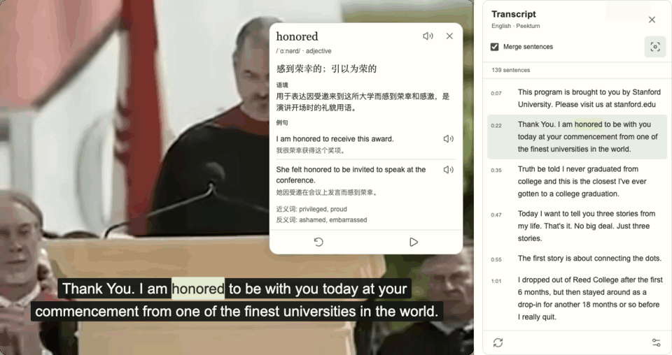
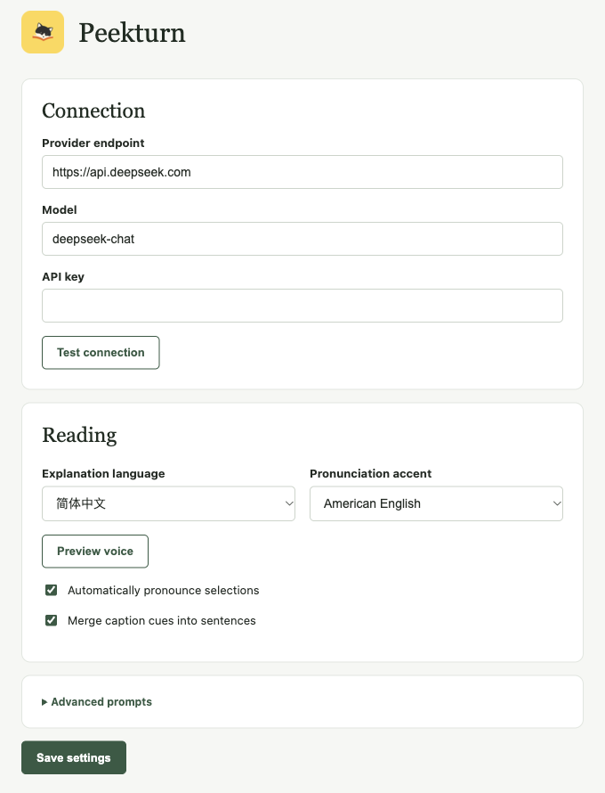

<div align="center">
  
  <h1>Peekturn for YouTube</h1>
  <p>看视频，读完整的英文句子。</p>
  <p>简体中文 · <a href="README.en.md">English</a></p>
  <p>Chrome Manifest V3 · Apache-2.0</p>
</div>



<p align="center"><sub>真实扩展录屏 · 12.5 秒 · 约 2 MB · GIF 无声音</sub></p>

Peekturn 是一个独立的 Chrome 扩展，和 Android 版 [Peekturn](https://github.com/Wake-C/peekturn) 属于同一系列。在 YouTube 上点击字幕或逐字稿中的单词，即可查看结合上下文的解释。

## 边看边读

- **完整句子**：默认用模型辅助合并字幕片段，同时用于视频字幕和右侧逐字稿。分组有长度和时间限制，保留原字幕文本。合并结果会在本机缓存，重新打开相同视频可直接复用；字幕、模型或合并规则变化时重新合并。合并进行中或不可用时，界面会说明并显示原始字幕。
- **点词解释**：点击两处字幕中的单词，在视频内的小弹窗中查看释义、语境和例句。解释可选英文或简体中文，两种语言都有默认提示词，也可以自定义或恢复默认。
- **听发音**：默认自动朗读所选单词，可选美音或英音。单词和例句旁的扬声器按钮可以播放或停止朗读。
- **控制播放**：查词时视频暂停。点击弹窗外会关闭解释，并恢复查词前正在播放的视频；原先暂停的视频保持暂停。关闭按钮仍会保持暂停，也可以手动重播当前句子或继续播放。
- **跟读逐字稿**：右侧紧凑排列的逐字稿标出当前句子，点击时间戳跳转。滚动时停止跟随，可用跟随按钮回到当前播放位置。顶部的复制图标可复制全文，不含时间戳。

## 安装

1. 在 [GitHub 仓库](https://github.com/Wake-C/peekturn-extension)点击 **Code → Download ZIP**，解压下载的文件。
2. 在 Chrome 打开 `chrome://extensions`，开启右上角的**开发者模式**。
3. 点击**加载已解压的扩展程序**，选择解压后包含 `manifest.json` 的文件夹。

直接加载即可，无需安装 npm 依赖或构建。点击 Chrome 工具栏中的 Peekturn 图标可打开设置。

## 配置模型

<p align="center"></p>

1. 自备模型 API 密钥。默认 Provider endpoint 是 `https://api.deepseek.com`，默认 Model 是 `deepseek-chat`；也可以填写支持 JSON 输出的 OpenAI 兼容 HTTPS 服务及其模型。
2. 在设置页填写 **Provider endpoint**、**Model** 和 **API key**，点击 **Save settings**。如果 Chrome 请求访问服务商地址，请允许。
3. 点击 **Test connection**，确认模型返回有效的结构化结果。然后打开有英文字幕的 YouTube 视频；必要时先打开 YouTube 字幕。

设置页还可以调整解释语言、发音、句子合并和提示词。服务商的使用费用及数据处理方式取决于你选择的服务。

## 隐私与限制

API 密钥保存在 Chrome 本地扩展存储中，不是操作系统加密保险库；扩展不会把密钥暴露给网页。查词时，所选单词、附近字幕、视频标题和时间戳会发给所配置的模型服务商；启用句子合并时，字幕片段也会发给该服务商。扩展本身不发送应用遥测数据。

合并缓存只保存内容指纹、分组边界和时间信息，最多保留 30 天。缓存限制为 1 MiB，超出限制时优先清理最久未使用的结果。

朗读使用 Chrome 的文字转语音功能，可用声音因浏览器和操作系统而异，部分声音可能需要联网。模型解释和合并需要可用的模型服务，不承诺离线 AI 功能。

扩展需要视频提供英文字幕，也依赖可能变化的 YouTube 内部字幕接口。它不绕过 YouTube 的访问限制。

## 开发

加载扩展不需要构建。运行项目检查建议使用 Node.js 22：

```sh
npm test
npm run check
```

## 许可证

本项目采用 [Apache License 2.0](LICENSE)。Lucide 图标及其 Feather 来源图标的 ISC、MIT 声明见[图标许可证](licenses/LICENSE-Lucide.txt)。

演示视频来自 Stanford 发布的 [Steve Jobs 2005 年斯坦福毕业演讲](https://www.youtube.com/watch?v=UF8uR6Z6KLc)，视频及 YouTube 品牌不属于本项目的软件许可证范围。来源和权利说明见 [NOTICE](NOTICE)。
